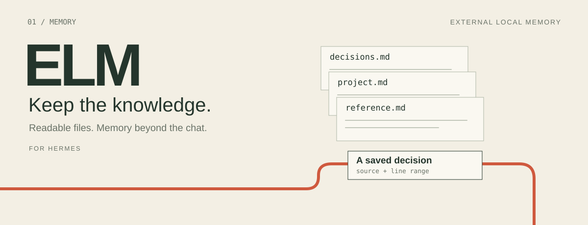
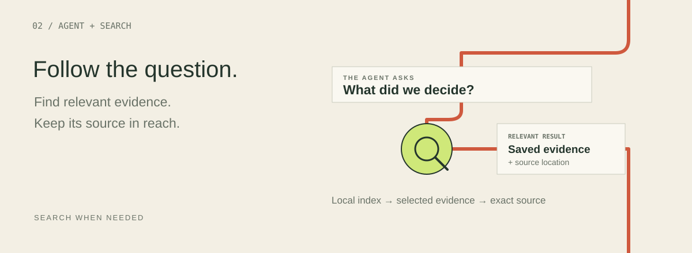
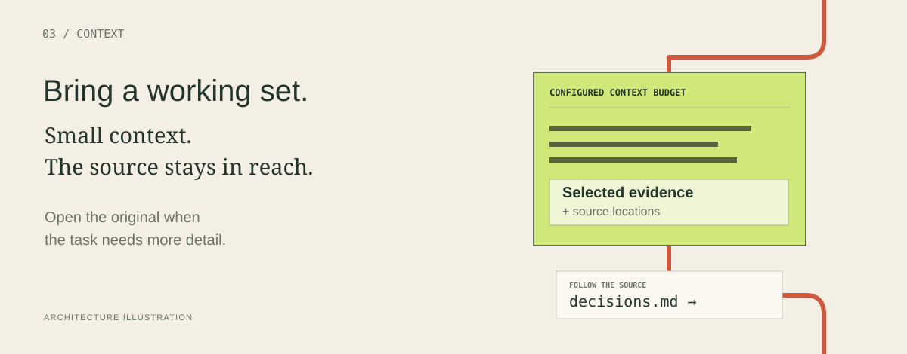

# ELM for Hermes

> **Experimental source candidate.** The current upstream Hermes host checked on 11 November 2026 lacks the session/project ownership APIs used by ELM's optional workspace and private-chat layer. That layer is not working on this checked stock host, and the full root test suite is not green. The offline core demo and selected regression checks pass. Please read [current test results](TEST_REPORT.md) before installation. The illustrations below explain the architecture; they are not screenshots or performance measurements.

ELM, **External Local Memory**, gives Hermes a local, inspectable foundation for long-running work. Keep project knowledge outside the conversation, retrieve relevant evidence when you need it, and follow the source when a detail matters.



Keep project knowledge in ordinary local Markdown and governed records. ELM’s derived SQLite FTS5 index makes the sources searchable and can be rebuilt from them.



The agent searches when the task needs prior knowledge. Retrieved evidence carries source locations, so a useful result can lead back to the original passage.



ELM returns a compact, source-linked working set. In Hermes, the complete successful context response can be measured against a selected local tokenizer and configured budget. Exact source reads remain available when more detail is needed.

[Installation](elm/README.md) · [Capabilities](elm/CAPABILITIES.md) · [Privacy and scope](elm/PRIVATE_CONTROLS.md) · [Token budgets](elm/docs/MEASURED_TOKEN_BUDGET.md)

## What makes ELM useful

### Your knowledge stays inspectable

Canonical knowledge lives in ordinary local Markdown and governed records. A derived SQLite FTS5 index makes it searchable. The index can be rebuilt from the source material, and retrieved records carry source locations so the agent can inspect the evidence behind a result.

You can read the memory yourself, maintain it alongside your work, and keep important decisions accessible beyond a single conversation.

### Context is selected, measured, and expandable

ELM retrieves a compact working set instead of repeatedly loading an entire knowledge store. The Hermes integration can measure the complete successful context response against an explicitly selected local tokenizer and a configurable budget. Exact source reads provide more detail when needed.

This puts a concrete boundary around ELM's context output. Whole-request cost still depends on the model, the conversation, other tools, and any additional reads.

### Different kinds of memory have different roles

The candidate supports declared **work**, **reference**, and **user-communication** lanes within an adopted project. Records preserve their stated source and basis, distinguishing explicit statements, preferences, observations, and uncertain hypotheses.

That separation helps keep project evidence, reference material, and communication preferences from becoming one undifferentiated pile of instructions. These are explicit declarations and retrieval rules, not automatic fact-checking or a hidden personality model.

### Learning stays under your control

Canonical access starts read-only, with explicit recall and capture off by default. Optional workflows support proposals, bounded agent-curated notes, and reviewed memory drafts. A pending draft remains pending; an agent's interpretation does not silently become an approved fact.

The integration also preserves uncertain save outcomes rather than blindly repeating a write. Native plugin settings, pending drafts, and Important results give users a concrete place to inspect and manage the candidate's memory workflows.

### Private chat and workspace controls

The current candidate includes explicit private-container creation controls and independent future-only defaults. A chat can read permitted workspace context while keeping its own authored memories separate. Existing chats and workspaces are not silently migrated.

Here, “private” describes memory ownership and logical access scope. It does not mean encrypted storage or local-only model inference.

### Choose conversation and memory processing separately

Conversation preferences and optional memory-processing preferences are separate. Where the host permits it, memory processing can use its existing auxiliary route, a selected provider/model, or a snapshot of the current chat's model at the moment a draft is requested.

This creates room to match the model to the job without changing global model settings. Existing host permissions, allowlists, and fallback behavior still apply.

## Built on a small local core

The core storage and retrieval path uses local files and SQLite FTS5. It does not require a hosted memory database, mandatory embeddings, a separate MCP service, or an extra model call just to search your knowledge.

The native integration brings that engine into Hermes through its plugin interfaces. Optional AI-assisted processing uses the host's configured model routes and may send eligible source material to those providers. Local storage and local inference are separate choices.

## Current stage

This repository contains an **experimental source candidate**, with engineering checks covering retrieval boundaries, memory controls, review workflows, and selected UI behavior. It is intended for careful evaluation, not presented as a one-click production release.

Earlier control checks used a preserved Hermes host and isolated fixtures. They do not establish compatibility with a clean stock installation. On checked upstream commit `6a0d2d12815c0546b0bcaf05046e2fe3293f60aa`, the required authoritative session/project ownership APIs are absent. ELM does not substitute CWD or sidebar selection for ownership. Workspace/private-chat features described above require a compatible host and remain blocked on that checked upstream version.

The current root suite ran 338 tests: **264 passed, 73 errors, 1 skipped**. Errors comprise 62 missing ownership-API fixture calls, 5 missing ownership-API runtime calls, 5 retained tests of the intentionally disabled updater, and 1 native-mount harness prerequisite. Four inherited regression lanes passed, but their counts overlap. The official plugin validator passed all 16 checks with 21 private/undocumented core import/call locations flagged for review. Validator success is not catalog approval or functional compatibility.

No fresh complete native UI acceptance, live-model answer-quality improvement, whole-workflow cost reduction, guaranteed API spending cap, independent security certification, or production readiness is claimed. See the [test report](TEST_REPORT.md), [qualification snapshot](QUALIFICATION.json), [installation guide](elm/README.md), [private-control notes](elm/PRIVATE_CONTROLS.md), and [capability matrix](elm/CAPABILITIES.md).

## What support would help us build next

Competition support, sponsorship, and community feedback would help accelerate these priorities:

- **Better memory structure and recall:** clearer working state, project knowledge, reference organization, and more reliable recovery after interruptions.
- **Speed and token efficiency:** faster retrieval and packing, better selection of useful evidence, and measurements of complete workflows rather than isolated component claims.
- **Useful skills from the start:** a curated starter collection for documentation research, coding, verification, effective delegation, and detecting unproductive loops.
- **Searchable skill discovery:** find the relevant procedure in a growing skill library, then load its full required instructions when needed instead of carrying every procedure in every prompt.
- **A clearer interface:** easier setup, memory inspection, review, privacy choices, and a more coherent visual identity and naming.
- **Broader integration:** preserve the reusable local engine while improving host-specific experiences.

These are development priorities, not features already included or guaranteed delivery dates. The goal is to make an agent more useful over time while keeping its memory understandable and controllable.

## A related direction: adaptive computer use

A **separate computer-use research track** is exploring a complementary layer that could work alongside ELM. Early prototypes cover bounded browser and selected desktop interactions; broader application support remains development work.

The proposed design would select an efficient model for the task, including local models where their capabilities fit. A focused visual worker could interpret a screen or UI state and return structured observations and action targets to the main agent. Native application interfaces and UI inspection would handle supported actions, with Playwright for browser automation and visual checks when structure alone is insufficient.

Task-specific MCP integrations would be available on demand. Reusable, verified interaction knowledge could help avoid rediscovering the same interface repeatedly, while supported background interfaces could allow work across multiple applications without unnecessarily taking over the user's mouse.

ELM would provide the memory and continuity foundation; the companion would handle perception and interaction. This is a future research direction, not a current ELM feature or a promise of universal background control.

## Help shape the next version

We welcome reproducible bug reports, real task examples, feedback on the interface, and evaluation of memory quality, latency, and cost. Sponsorship or competition support would help turn this tested foundation into a more polished, easier-to-use product.

**The ambition is practical: let agents carry useful knowledge forward, spend context where it helps, and keep the user in control.**

## Reproduce the offline core demonstration

With Python 3.11+ and SQLite FTS5, run from this repository:

```sh
cd elm
python -B demo.py
python -B verify_release.py
```

The demonstration uses temporary synthetic records and no model call or live Hermes profile. It retrieves evidence, opens an exact source, and checks boundaries across restart. It is an engine demonstration, not end-to-end Hermes acceptance. The installable plugin lives in `elm/`; optional named-tokenizer accounting requires separately prepared pinned dependencies and local vocabularies.

## Behavior disclosures

- ELM reads its selected local memory root and host-owned profile, session, and project metadata. Approved operations write local stores according to the configured mode.
- Engine operations spawn the same Python interpreter against bundled source with a restricted environment and no shell-command interpolation.
- Optional human-requested learning drafts can send approved selected source text to the user's configured host model provider. Local storage does not imply local inference.
- Explicit human-selected skill checks and updates use Hermes's native source and scan flow and can contact configured skill sources. Plugin-code updates are disabled in this export; use Hermes's native reviewed-catalog update flow.
- The export has no plugin telemetry and does not hold provider credentials. Logical memory scope is not encryption, complete DLP, or guaranteed complete erasure.

For details, read [security](elm/SECURITY.md), [private controls](elm/PRIVATE_CONTROLS.md), and [export notes](PUBLIC_EXPORT_NOTES.md). Legacy/project-root and workspace providers are alternative modes, not additive tool sets.

## License

Apache License 2.0. Original source and bundled-engine notices are preserved in [LICENSE](LICENSE) and [NOTICE](NOTICE). The optional tokenizer has a separately retained license.
